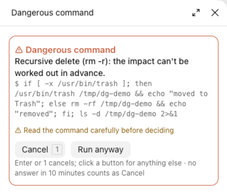

# danger-guard

English · [简体中文](README.zh-CN.md)

Before Claude deletes files, runs a risky git command or edits files outside the project, it stops and asks you on a card. Deletes go to the Trash by default, and git commands show what they would lose first.



*Here Claude wrote a delete wrapped in if/else, whose effect can't be read in advance, so the general card appears; a plain `rm` lists each item it would remove on the card.*

## Highlights

- **Deletes**: an `rm` lists every item it would remove, with its file count, size and git status. The default is **Move to Trash**; you can also cancel or delete permanently. Deleting a few committed files in the project doesn't interrupt you, but they still go to the Trash.
- **git**: `reset --hard`, force push, `clean`, `branch -D` and the like first work out which changes and commits would be lost, then ask.
- **Critical folders** (your home folder, `~/Library`, `/Applications` and others) can't be deleted recursively at all.
- **Other dangerous commands** (dropping a database, `terraform destroy`, `kubectl delete`, `npm publish` and others) need a click on **Run anyway**.
- **Files outside the project**: Claude asks before editing them.
- Dangerous commands and edits to secrets files (`.env`, `~/.ssh/` and others) still ask in bypass and auto permission modes.
- No answer within 10 minutes counts as Cancel, and Claude is told not to retry.

## Install

```
/plugin install danger-guard --marketplace Yao0558/claude-code-mods
```

Requirements, other ways to install, the interface language, changing the code and tests: see the [repository README](../README.md).

## Details

<details>
<summary>Using the card</summary>

The card opens in the side pane; when the pane has no room, Claude Code's own question dialog shows the same choices. In the side pane, **Enter** or **1** cancels and anything else needs a click; closing the pane also counts as Cancel. In the question dialog, choose with the keyboard as usual. While a card is open, the turn waits for your answer, for up to 10 minutes.

</details>

<details>
<summary>Deletes (<code>rm</code>)</summary>

The list-and-Trash flow applies to a plain `rm` command, optionally after `cd <folder> &&`. Other forms of a recursive delete (`sudo rm -r`, `/bin/rm -r`, `rm -r x; ls`, paths in variables) get the general **Run anyway** card instead, without the list.

- The list marks what each item is: a whole repo, git history, uncommitted changes, not in git, outside the project. Risky items come first.
- Choices: **Cancel** · **Move to Trash** (default) · **Delete permanently**.
- Only the paths on the card are handled: wildcards aren't expanded a second time, and a symlink written as `link/` removes only the link, not the folder it points to.
- No card only when all of these hold: at most 3 files, not recursive, all inside the project and all committed in git (or stale `.git/*.lock` files).

**Recursive deletes refused outright**: `/`, your home folder, `~/Library`, `~/Documents`, `~/Desktop`, `/Users` and every user folder in it, `/Volumes` and every disk in it, `/System`, `/Applications`, `/Library`, `/usr`, `/usr/local`, `/opt`, `/opt/homebrew`, `/bin`, `/sbin`, `/etc`, `/var`, `/tmp`, `/private` and similar. Deleting them via `sudo`, `/bin/rm`, a symlink or different letter case is refused too. Only paths written out in the command can be recognized in advance; a path held in a variable gets the **Run anyway** card.

</details>

<details>
<summary>git commands</summary>

Only a single git command is previewed (optionally after `cd <folder> &&`); other forms get the general card without the list.

| Command | What the card shows |
| --- | --- |
| `git reset --hard` | files with uncommitted changes, commits that leave the branch |
| `git checkout .` / `restore` / `switch -f` | files whose changes would be discarded |
| `git clean` | untracked files and folders that would be deleted |
| `git push --force` | remote commits you don't have locally that would be dropped |
| `git push --delete` / `--prune` / `--mirror` | remote branches deleted, and commits on no other branch |
| `git branch -D` | commits not merged into the current branch |
| `git stash drop` / `clear` | stashes that would be dropped |

Force-push previews use the remote as of your last `git fetch`; if others pushed since, more may be lost.

</details>

<details>
<summary>Other dangerous commands</summary>

These need a click on **Run anyway**: `DROP TABLE`/`DROP DATABASE` sent through a database client (psql, mysql, sqlite3, mongosh, bq, wrangler and others), `dropdb`, `find -delete` or `-exec rm`, disk formatting, `dd`, Docker volume prune, `kubectl delete`, `terraform destroy`, `npm publish`, `rimraf`, `rsync --delete`, `unlink`, `shred`/`srm`.

Commands whose effect can't be seen in advance ask too: a variable used as the program name, `eval` or `sh -c` with a built-up string, or output piped into a shell.

**How commands are read**: the whole command is split the way the shell splits it. Commands inside `sudo`, `xargs`, `if`/`for` are checked, and so are those in `sh -c '…'`, `eval`, `$(…)` and heredocs fed to a shell. Text inside quotes, comments and plain heredoc bodies doesn't count.

</details>

<details>
<summary>Edits outside the project</summary>

Applies to `Edit`, `Write` and `NotebookEdit`.

- A file outside the current project asks: **Allow once**, or **Allow for this session** for the folder it belongs to. That folder is its git repo root, or its parent folder outside a repo; for broad folders such as your home folder only **Allow once** is offered.
- Not asked: files in the project, project memory folders (`~/.claude/projects/*/memory/`) and temporary folders (`/tmp`, `/private/tmp`, `$TMPDIR`).
- Files under `~/.claude` (settings, mods, skills, global rules) ask every time and only offer **Allow once**. The exception: when the project itself is in a subfolder of `~/.claude`, its files count as ordinary project files. Opening `~/.claude` itself as the project doesn't count.
- Paths are checked after resolving `~`, relative paths and symlinks, so a link can't lead an edit somewhere else unnoticed.

</details>

<details>
<summary>In bypass and auto permission modes</summary>

A dangerous command, or an edit to a secrets file (`.env`, `*.pem`, `*.key`, `id_rsa`, `credentials.json`, `.netrc`, `.npmrc`, `~/.ssh/`, `~/.aws/`, `~/.kube/config` and similar; templates such as `.env.example` are fine), still needs your confirmation in bypass or auto permission mode. Deny rules in your settings always win.

</details>

## Limits

- It guards against mistakes; it isn't a sandbox. Only `Bash`, `Edit`, `Write` and `NotebookEdit` are checked; other tools, including MCP tools, pass through.
- It errs toward asking: a command it can't read with confidence gets a card.
- In non-interactive runs (`claude -p`) there is no one to ask, so risky actions are cancelled.
- Written for macOS:
  - **Move to Trash** runs the `trash` command on your `PATH`; recent macOS ships one at `/usr/bin/trash`. Without it the move fails with an error and nothing is deleted.
  - Critical folders follow the macOS layout; Linux paths such as `/home/<name>` aren't on the list.
  - Temporary folders are recognized by macOS paths (`/private/tmp`, and `$TMPDIR` only when it looks like `/var/folders/…/T`).
  - Path comparisons ignore letter case; on a case-sensitive Linux disk that can be too lenient.
  - Wildcards are previewed with your `$SHELL` when it is zsh or bash, otherwise with `/bin/zsh`; without `/bin/zsh` the preview fails and every `rm` asks.

## License

[MIT](LICENSE) © Lu Shiyao
