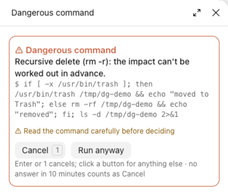

# danger-guard

[English](README.md) · 简体中文

Claude 要删东西、执行有风险的 git 命令、改项目外的文件之前，先停下来在卡片上问你。删除默认移到废纸篓，git 操作先告诉你会丢什么。



*截图里 Claude 写的是带 if/else 的删除命令，看不出会删什么，所以弹的是通用的确认卡片；单纯的 `rm` 会在卡片上逐项列出要删的东西。截图为英文界面。*

## 要点

- **删除**：用 `rm` 删除时，逐项列出要删的东西：文件数、大小、有没有提交到 git。默认**移到废纸篓**，也可以取消或永久删除。删项目里少量已提交的文件不打扰你，但同样是移到废纸篓。
- **git**：`reset --hard`、强推、`clean`、`branch -D` 这类操作，先算出会丢哪些改动和提交，再问你。
- **关键目录**（主目录、`~/Library`、`/Applications` 等）的递归删除直接拒绝。
- **其它危险命令**（删数据库、`terraform destroy`、`kubectl delete`、`npm publish` 等）要你点**继续执行**。
- **项目外的文件**：Claude 要改项目目录外的文件，先问你。
- 危险命令和改密钥文件（`.env`、`~/.ssh/` 等），在 bypass、auto 权限模式下也照样问。
- 10 分钟没人回答算取消，并告诉 Claude 不要重试。

## 安装

```
/plugin install danger-guard --marketplace Yao0558/claude-code-mods
```

版本要求、其它装法、界面语言、改代码自己用和测试，见[仓库首页](../README.zh-CN.md)。

## 详细规则

<details>
<summary>卡片怎么操作</summary>

卡片出现在侧边面板里；面板放不下时，改用 Claude Code 自带的提问框，选项一样。侧边面板里按**回车**或 **1** 是取消，其它选项要点按钮；关掉面板也算取消。提问框照常用键盘选。卡片开着时，这一轮会等你回答，最多 10 分钟。

</details>

<details>
<summary>删除（<code>rm</code>）</summary>

列清单、移到废纸篓的流程只适用于单纯的 `rm` 命令，前面可以有 `cd <目录> &&`。别的写法的递归删除（`sudo rm -r`、`/bin/rm -r`、`rm -r x; ls`、路径放在变量里）弹的是普通的**继续执行**卡片，不列清单。

- 清单里标出每一项的情况：整个仓库、含 git 历史、有未提交的改动、不在 git 里、在项目外。有风险的排在前面。
- 选项：**取消** · **移到废纸篓**（默认）· **永久删除**。
- 只处理卡片上列出的路径：通配符不会再展开一遍；写成 `link/` 的符号链接只删链接本身，不删它指向的文件夹。
- 同时满足这几条时不弹卡片：最多 3 个文件、不递归、都在项目里、都已提交到 git（或是 git 中断后留下的 `.git/*.lock`）。

**直接拒绝递归删除的目录**：`/`、主目录、`~/Library`、`~/Documents`、`~/Desktop`、`/Users` 及其下每个用户目录、`/Volumes` 及其下每个磁盘、`/System`、`/Applications`、`/Library`、`/usr`、`/usr/local`、`/opt`、`/opt/homebrew`、`/bin`、`/sbin`、`/etc`、`/var`、`/tmp`、`/private` 等。用 `sudo`、`/bin/rm`、借符号链接、换大小写都一样拒绝。只有路径直接写在命令里才能事先认出来；放在变量里的路径弹**继续执行**卡片。

</details>

<details>
<summary>git 操作</summary>

只预览单独一条 git 命令（前面可以有 `cd <目录> &&`）；别的写法弹普通卡片，不列清单。

| 命令 | 卡片上列出 |
| --- | --- |
| `git reset --hard` | 有未提交改动的文件、会离开当前分支的提交 |
| `git checkout .` / `restore` / `switch -f` | 改动会被丢掉的文件 |
| `git clean` | 会被删掉的未跟踪文件和文件夹 |
| `git push --force` | 远端有、本地没有、会被冲掉的提交 |
| `git push --delete` / `--prune` / `--mirror` | 会被删的远端分支，以及不在别的分支上的提交 |
| `git branch -D` | 没合并进当前分支的提交 |
| `git stash drop` / `clear` | 会被丢弃的暂存 |

强推的预览按你上次 `git fetch` 时的远端算；之后别人又推过，实际丢的会更多。

</details>

<details>
<summary>其它危险命令</summary>

这些要你点**继续执行**：通过数据库客户端（psql、mysql、sqlite3、mongosh、bq、wrangler 等）执行的 `DROP TABLE`/`DROP DATABASE`、`dropdb`、`find -delete` 或 `-exec rm`、格式化磁盘、`dd`、清理 Docker 卷、`kubectl delete`、`terraform destroy`、`npm publish`、`rimraf`、`rsync --delete`、`unlink`、`shred`/`srm`。

事先看不出会做什么的命令也要问：用变量当程序名、用 `eval` 或 `sh -c` 执行拼出来的字符串、把输出交给 shell 执行。

**怎么认命令**：按 shell 的规则拆开整条命令，`sudo`、`xargs`、`if`/`for` 里面的命令照样检查，`sh -c '…'`、`eval`、`$(…)` 和交给 shell 执行的 heredoc 里的也查；引号里的文字、注释、普通 heredoc 的正文不算。

</details>

<details>
<summary>改项目目录外的文件</summary>

适用于 `Edit`、`Write`、`NotebookEdit`。

- 不在当前项目里的文件要确认：**允许这一次**，或对它所属的目录**本会话都允许**。所属目录是它所在 git 仓库的根，不在仓库里就是它的上级目录；主目录这类太大的目录只给“允许这一次”。
- 不问：项目里的文件、各项目的记忆目录（`~/.claude/projects/*/memory/`）、临时目录（`/tmp`、`/private/tmp`、`$TMPDIR`）。
- `~/.claude` 下的文件（设置、mod、技能、全局规则）每次都问，只给**允许这一次**。例外：项目本身在 `~/.claude` 下面的某个子目录里时，项目里的文件照普通项目文件处理；直接把 `~/.claude` 当项目不算。
- 路径先把 `~`、相对路径和符号链接都解开再判断，借链接改到别处也认得出。

</details>

<details>
<summary>bypass、auto 权限模式下</summary>

危险命令，或改密钥一类的文件（`.env`、`*.pem`、`*.key`、`id_rsa`、`credentials.json`、`.netrc`、`.npmrc`、`~/.ssh/`、`~/.aws/`、`~/.kube/config` 等；`.env.example` 这类模板不算），即使权限模式是 bypass 或 auto 也要你确认。设置里明令禁止的照样禁止。

</details>

## 限制

- 它防的是失手，不是沙箱：只检查 `Bash`、`Edit`、`Write`、`NotebookEdit`，别的工具（包括 MCP 工具）不管。
- 宁可多问：看不准的命令一律弹卡片。
- 非交互运行（`claude -p`）时没人可问，有风险的操作一律取消。
- 按 macOS 写的部分：
  - **移到废纸篓**用 `PATH` 里的 `trash` 命令，新版 macOS 自带 `/usr/bin/trash`。没有这个命令时会报错，什么也不删。
  - 关键目录按 macOS 的目录结构列；Linux 的 `/home/<用户>` 这类不在名单里。
  - 临时目录按 macOS 的路径认（`/private/tmp`；`$TMPDIR` 要像 `/var/folders/…/T` 才算）。
  - 路径比较不分大小写；在区分大小写的 Linux 磁盘上会偏宽松。
  - 通配符用你的 `$SHELL`（zsh 或 bash）预览，别的 shell 改用 `/bin/zsh`；连 `/bin/zsh` 也没有时预览会失败，每个 `rm` 都要问。

## 许可

[MIT](LICENSE) © Lu Shiyao
