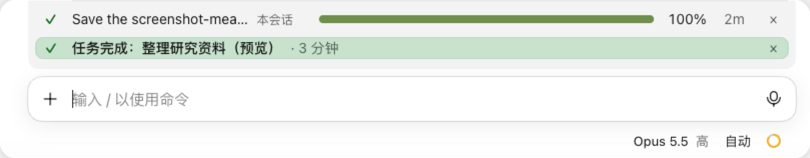

# done-alert

[English](README.md) · 简体中文

长任务跑完时提醒你：输入框正上方留一条提示，写着任务名和用时，完成是绿色，出错是红色；你在跟前时再响一声。



*截图里的提示是用 `/done-alert-preview` 生成的预览。*

## 要点

- 一轮真正干活超过 60 秒才提醒，等你点“允许”、回答提问、批准计划的时间不算。
- 提示一直留到你发下一条消息或点 **×**，离开一会儿回来也看得到。
- 桌面 App 在最前面时响一声；App 在后台时，交给 App 自带的“任务完成”通知（要在 App 的通知设置里打开）。
- 终端里响一声（只有 macOS），并按 Claude Code 的通知设置发一条通知。
- 想先看看效果，不用真等一个长任务：`/done-alert-preview` 看完成提示，`/done-alert-preview fail` 看出错提示。

## 安装

```
/plugin install done-alert --marketplace Yao0558/claude-code-mods
```

版本要求、其它装法、界面语言、改代码自己用和测试，见[仓库首页](../README.zh-CN.md)。

## 详细规则

<details>
<summary>什么时候提醒、显示什么</summary>

- 完成：`✓ 任务完成：<任务名> · 4 分钟`。因出错或拒绝而结束的一轮是红色：`✗ 任务出错停下了`。
- 任务名取开始这一轮的那条消息的第一行，最多 30 个字；斜杠命令就用命令和参数。系统接着跑的一轮（后台任务完成、系统提醒）沿用上一个任务名。
- 子代理的一轮、你自己打断的一轮都不提醒。
- 和其它在输入框上方显示内容的 mod（如 repo-bar、task-progress）一起用时，各占一行，完成提示紧贴输入框。

</details>

<details>
<summary>声音和通知</summary>

- **桌面 App**：只有 Claude App 在最前面时才响。App 在后台时由它自带的“任务完成”通知提醒，要在 App 的通知设置里打开。
- **终端**：响一声（只有 macOS 会响，Linux 和 Windows 的终端没有播放器），并按 Claude Code 的通知设置（`preferredNotifChannel`）发一条通知，设置里关了就不发。
- `sounds/` 里的两个声音是 `sounds/synth.py` 用正弦波合成的原创素材，和 mod 一样按 MIT 发布。在 macOS 上运行 `python3 sounds/synth.py` 可以重新生成；想换声音就改这个脚本。

</details>

## 限制

- App 是否在最前面，用 macOS 的 `lsappinfo` 命令判断；别的系统上查不了，就当 App 一直在前面，每次都响。
- 桌面会话里 mod 自己不发系统通知，App 在后台时全靠 App 自带的通知。
- 60 秒的门槛和 30 个字的任务名是固定的，不能配置；要改得改代码（`hooks/register.tsx` 的 `MIN_MS`、`TASK_MAX`）。
- 别的 mod 的确认卡片（如 danger-guard 的），你点了取消或超时没回答的，那段等待会算进干活时间。

## 许可

[MIT](LICENSE) © Lu Shiyao
