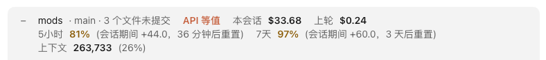

# repo-bar

English · [简体中文](README.zh-CN.md)

One row above the prompt that tells you which repo and branch you are in and whether anything is uncommitted. It also shows what the session has cost, how much of your plan's quotas is used, and how full the context is.



*Shown with the Chinese interface; the labels are in English when your [interface language](../README.md#interface-language) is English.*

## Highlights

- **Where you are**: the repo or folder name, the branch, and `N uncommitted` or `clean`.
- **What it cost**: the session and the last turn, in dollars at API prices.
- **Quotas** (subscriptions): how much of the 5-hour, 7-day and spend-limit quotas is used; yellow at 80%, with when it resets.
- **Context**: tokens used and the percentage; yellow at 80%.
- Click **−** to collapse the row to just the numbers and **+** to expand it. This applies to the current session only; new sessions start expanded.

## Install

```
/plugin install repo-bar --marketplace Yao0558/claude-code-mods
```

Requirements, other ways to install, the interface language, changing the code and tests: see the [repository README](../README.md).

## Owner labels (optional)

If you work for several companies or clients, you can show who each repo belongs to before its name. In the `entities` option, add one entry per owner written as `text=Name`, such as `acme=Acme Inc.`: when the repo path or its `origin` URL contains the text (any letter case), the name is shown; if several match, the first one wins.

Installing asks for this option; leave it empty if you don't need it, and change it later in `/config`.

## Details

<details>
<summary>The rest of the row</summary>

What the highlights leave out:

- The owner label, if set up, comes before the repo name. `N uncommitted` counts changed and untracked files; outside git the row shows `not a git repo`.
- **API equiv.**: shown on a subscription, as a reminder that the dollar figures are API-price equivalents, not what you pay.
- The labels are **Session**, **Last turn**, **5h**, **7d**, **Spend limit** and **Context**. After a quota, `+x since start` is how much it rose since this session started (other sessions open at the same time included).

</details>

<details>
<summary>When it updates</summary>

- Usage is pushed by Claude Code at the end of each turn and whenever a quota moves. While a turn runs it also reads usage every 15 seconds; when idle, every 2 minutes.
- The repo and branch are re-read after Claude runs a git command that can move the branch or change what's uncommitted (`checkout`, `commit`, `pull`, `add`, `stash` and the like) or `cd`; other changes (such as edited files) show at the end of the turn.
- The cost baselines of the last 20 sessions and the latest quota readings are saved in the mod's own store, so they survive an app restart. Quotas are account-wide, but only subscription sessions show them.

</details>

## Limits

- Dollar figures are what the tokens would cost at API prices; on a subscription they are not what you are billed.
- Quotas come from Claude Code with each reply. Right after the app restarts, they show only once a reply brings them in, and one reply doesn't always carry every quota.

## License

[MIT](LICENSE) © Lu Shiyao
