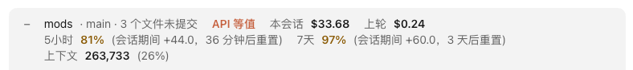

# repo-bar

[English](README.md) · 简体中文

输入框上方一行，告诉你在哪个仓库、哪个分支、有没有未提交的文件，以及这个会话花了多少、套餐额度和上下文用了多少。



## 要点

- **在哪里**：仓库或目录名、分支，以及 `N 个文件未提交` 或 `已干净`。
- **花了多少**：本会话和上一轮的花费，按 API 价格算的美元数。
- **额度**（订阅用户）：5 小时、7 天和花费上限各用了多少；到 80% 变黄，并显示多久后重置。
- **上下文**：占了多少 token、多少比例；到 80% 变黄。
- 点 **−** 收起成只剩数字，点 **+** 展开。只对当前会话有效，新会话默认展开。

## 安装

```
/plugin install repo-bar --marketplace Yao0558/claude-code-mods
```

版本要求、其它装法、界面语言、改代码自己用和测试，见[仓库首页](../README.zh-CN.md)。

## 所属主体（可选）

同时给几家公司或客户干活时，可以在仓库名前面标上它属于谁。在配置项 `entities` 里每项写一条 `字样=名字`，如 `acme=Acme 公司`：仓库路径或 `origin` 地址里含这段字样（不分大小写），就显示这个名字；几条都对得上时，用排在前面的那条。

安装时会问这一项，不需要就留空；以后在 `/config` 里改。

## 详细规则

<details>
<summary>这一行的其它内容</summary>

要点里没提到的几处：

- 所属主体配了才显示，在仓库名前面。`N 个文件未提交` 含改过的和未跟踪的文件；不在 git 里显示 `非 git 目录`。
- **API 等值**：订阅用户才显示，提醒你后面的美元数是按 API 价格折算的，不是实际付的钱。
- 标签依次是 **本会话**、**上轮**、**5小时**、**7天**、**花费上限**、**上下文**。额度后面的 `会话期间 +x` 是这个会话开始以来涨了多少（同时开着的别的会话用掉的也算在内）。

</details>

<details>
<summary>什么时候更新</summary>

- 用量由 Claude Code 在每轮结束、额度每变动一次时推送过来；一轮进行中另外每 15 秒读一次，空闲时每 2 分钟一次。
- Claude 跑过可能换分支、改变未提交文件的 git 命令（`checkout`、`commit`、`pull`、`add`、`stash` 这类）或 `cd` 后，重新读仓库和分支；别的改动（如直接改文件）在这一轮结束时更新。
- 最新的额度读数和最近 20 个会话的花费基准存在 mod 自己的存储里，App 重开后接得上。额度是整个账号共用的，但只有订阅会话才显示。

</details>

## 限制

- 美元数是这些 token 按 API 价格算的钱；订阅用户实际并不按这个付费。
- 额度随每次回复由 Claude Code 带来。App 刚重开时，要等一次回复带来读数才显示，而且一次回复不一定带齐所有额度。

## 许可

[MIT](LICENSE) © Lu Shiyao
