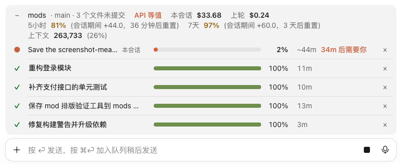

# task-progress

English · [简体中文](README.zh-CN.md)

Above the prompt of every session, lists the task each session is working on: a progress bar, the percentage and the time left. Finished tasks turn green, and clicking a name takes you to that session.



*Shown with the Chinese interface; the labels are in English when your [interface language](../README.md#interface-language) is English.*

## Highlights

- One row per session, up to 6; running tasks come first, and your own session is marked **this session**.
- Progress comes from Claude's task list. With estimates on its steps, the time left shows from the start, and steps marked "needs you" also tell you ahead of time when you have to be there. See how to write them below.
- Finished tasks turn green and ones that stopped on an error red, and both disappear after 30 minutes; quick back-and-forth exchanges aren't listed.
- Click a name to jump to that desktop session, or **×** to hide a row.

## Install

```
/plugin install task-progress --marketplace Yao0558/claude-code-mods
```

**Install it at the user scope**: a session only shows up in the list if the mod runs in it.

Requirements, other ways to install, the interface language, changing the code and tests: see the [repository README](../README.md).

## Writing estimates

End a step of the task list with its estimate in round brackets, `()` or `（）`:

| Written as | Meaning |
| --- | --- |
| `Export the volumes (20-40 min)`, `导出数据卷（20–40分）` | a range; a single duration works too |
| `(1h30m)`, `(1 小时 30 分)`, `(1.5h)` | a duration in several parts, or with decimals |
| `Run it on the old Mac (10 min, needs you)`, `在旧机执行（10分·需要你）` | you have to be there for this step (shown only when at least one step has an estimate); a negation in the brackets (`no need`, `不需`, `无需` and the like) cancels it |

Units are seconds (`s`, `sec`, `second`, `秒`), minutes (`m`, `min`, `minute`, `分`, `分钟`) and hours (`h`, `hr`, `hour`, `小时`); English units in lower case only, plural forms too. Only the brackets at the very end of a step are read; an estimate that can't be read, is 0 or is over a week counts as none.

Claude doesn't put estimates in its task list by default. For time left, add a line to `~/.claude/CLAUDE.md`, for example:

```text
End each step of the task list with its estimate in brackets, such as "Export the data (20-40 min)"; add "needs you" in the brackets for steps I have to be there for.
```

## Details

<details>
<summary>How progress and time left are worked out</summary>

Progress comes from the task list Claude keeps: `update_plan` in the desktop app, `TodoWrite` in the terminal.

- **No task list**: the row shows how long the task has run; in the desktop app a short segment slides along the bar.
- **No estimates**: by step count, with completed steps counting fully and the step in progress counting half. Time left is worked out once at least one step is done; until then the row shows how long it has run.
- **With estimates** (the list is unfinished and at least one step has one):
  - Time left shows right away, as a range such as `~20–40m`; steps without an estimate count as the average of those with one.
  - The percentage weighs steps by their estimates; a running row stops at 99%.
  - Once the task has run longer than the upper ends added up, the time turns to the warning colour; from a minute over it reads `15m over` instead. It also turns that colour, still showing the time left, when the step in progress runs past its own upper end.
  - The first unfinished step marked `needs you` shows after the time, in the accent colour: `needs you in 25m` before it starts, `needs you` while it is in progress.

</details>

<details>
<summary>What is listed and when rows disappear</summary>

- A running task appears after 20 seconds, or as soon as it has a task list; a turn shorter than 30 seconds isn't listed once done.
- When a turn ends the row turns green with ✓ and how long it took, or red if it stopped on an error or a refusal. Finished rows disappear after 30 minutes; a turn you interrupt disappears right away.
- The name is the session's title in the desktop app, otherwise the first line of the message that started the turn. Only other desktop sessions can be clicked; your own session and terminal sessions show plain names.
- **×** hides a row in every session until that session starts a new turn.
- A turn the system starts (a background task finishing, a reminder) continues the same task instead of starting a new row, if that task ended less than 30 minutes ago.

</details>

<details>
<summary>How sessions see each other (files it writes)</summary>

Each session writes its status to `~/.claude/task-progress/<session id>.json`, and every session reads that folder. A running session that stops updating for 90 seconds is treated as gone; status files untouched for a week are deleted automatically. Non-interactive runs (`claude -p`) don't write anything.

</details>

## Limits

- Session titles and click-to-jump work only with the Claude desktop app on macOS: titles are read from `~/Library/Application Support/Claude/claude-code-sessions/`, and the jump opens a `claude://code/continue?session=…` link with `open`. Elsewhere rows still show, but names fall back to the first line of the message and can't be clicked. Neither the folder nor the link is a documented interface of the app, so an app update can break them.
- Only `update_plan` and `TodoWrite` are read; other task tools give no percentage.
- Not built for Windows: it needs `HOME`, and uses `rm` to clean up old status files.
- Time left is only as good as the task list: without estimates, steps of very different sizes make it a rough guess; with estimates, it is only as good as the estimates.
- Time counts from the start of the turn, including the time before the task list is written and the time spent waiting for you to allow a tool; for a task a system turn carries on, also the gap since it ended. All of it counts towards `over`.
- In a narrow terminal the **this session** tag and the needs-you note are dropped first; narrower still, the progress bar and then the time are dropped.

## License

[MIT](LICENSE) © Lu Shiyao
