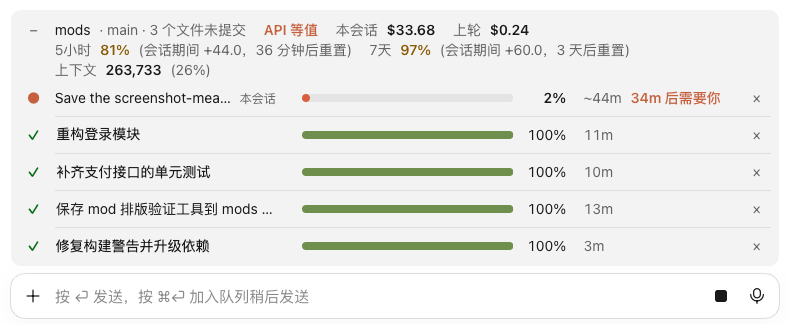

# task-progress

[English](README.md) · 简体中文

在每个会话的输入框上方，列出所有会话正在跑的任务：进度条、百分比、还剩多久。完成的变绿，点名字就跳到那个会话。



## 要点

- 每个会话一行，最多 6 行；正在跑的排前面，你自己的会话标着**本会话**。
- 进度来自 Claude 的任务清单。步骤写了估时，开工就能算出还剩多久，标了“需要你”的步骤还会提前告诉你什么时候要在场。写法见下文。
- 完成变绿、出错变红，30 分钟后消失；一问一答的短对话不列。
- 点名字跳到那个桌面会话，点 **×** 收起一行。

## 安装

```
/plugin install task-progress --marketplace Yao0558/claude-code-mods
```

**要装在用户范围**：只有加载了这个 mod 的会话，才会出现在列表里。

版本要求、其它装法、界面语言、改代码自己用和测试，见[仓库首页](../README.zh-CN.md)。

## 估时怎么写

在任务清单每一步末尾的圆括号里写，全角半角都行：

| 写法 | 意思 |
| --- | --- |
| `导出数据卷（20–40分）`、`Export the volumes (20-40 min)` | 一个区间；也可以只写一个时长 |
| `（1h30m）`、`（1 小时 30 分）`、`（1.5小时）` | 几段组成的时长、带小数的时长 |
| `在旧机执行（10分·需要你）`、`Run it on the old Mac (10 min, needs you)` | 这一步要你在场（清单里至少有一步写了估时才提示）；括号里带否定（`不需`、`无需`、`no need` 这类）就不算 |

单位是秒（`秒`、`s`、`sec`、`second`）、分（`分`、`分钟`、`m`、`min`、`minute`）或小时（`小时`、`h`、`hr`、`hour`），英文单位只认小写，复数也行。只读步骤最末尾的那个括号；读不出来的，或估时是 0、超过一周的，当没写。

Claude 默认不在任务清单里写估时。想看剩余时间，在 `~/.claude/CLAUDE.md` 里加一句，例如：

```text
任务清单的每一步末尾用括号写估时，如“导出数据（20–40分）”；要我在场的步骤在括号里加“需要你”。
```

## 详细规则

<details>
<summary>进度和剩余时间怎么算</summary>

进度来自 Claude 的任务清单：桌面 App 里是 `update_plan`，终端里是 `TodoWrite`。

- **没有任务清单**：显示已经跑了多久；桌面 App 里进度条上一小段来回滑动。
- **没写估时**：按步数算，做完的步骤算一整步，正在做的算半步；做完至少一步才估剩余时间，之前显示已经跑了多久。
- **写了估时**（清单还没做完，至少有一步写了）：
  - 开工就显示还剩多久，是个区间，如 `~20–40m`；没写估时的步，按写了的那些步的平均值算。
  - 百分比按估时加权；正在跑的最多显示 99%。
  - 跑的时间超过各步上限之和，时间变成警示色；超出满 1 分钟后改为显示 `超预计 15m`。正在做的那步超过它自己的上限时也变色，但仍显示还剩多久。
  - 第一个还没做完、标了“需要你”的步骤，在时间后面用强调色提示：还没做到时显示 `25m 后需要你`，正在做时显示 `需要你`。

</details>

<details>
<summary>哪些会列出、什么时候消失</summary>

- 正在跑的任务 20 秒后才列出，有任务清单的立刻列出；跑了不到 30 秒就结束的一轮，完成后不列。
- 一轮结束时变绿、打 ✓，显示用了多久；因出错或拒绝而停下的变红。完成的行 30 分钟后消失；你打断的那一轮立刻消失。
- 名字用桌面 App 里的会话标题，没有就用开始这一轮的那条消息的第一行。只有别的桌面会话的名字能点；本会话和终端会话只显示名字。
- **×** 在所有会话里收起这一行，直到那个会话开始新的一轮。
- 系统接着跑的一轮（后台任务完成、系统提醒），如果原来的任务结束不到 30 分钟，就接着算那个任务，不另起一行。

</details>

<details>
<summary>会话之间怎么互相看到（会写哪些文件）</summary>

每个会话把自己的状态写到 `~/.claude/task-progress/<会话 id>.json`，所有会话都读这个目录。正在跑的会话 90 秒没更新，就当它已经不在了；一周没动的状态文件自动删掉。非交互运行（`claude -p`）什么都不写。

</details>

## 限制

- 会话标题和点名字跳转只在 macOS 的 Claude 桌面 App 里有：标题从 `~/Library/Application Support/Claude/claude-code-sessions/` 里读，跳转用 `open` 打开 `claude://code/continue?session=…` 链接。别的系统上照样列出各行，但名字退回到消息的第一行，也不能点。这个目录和链接都不是 App 公开说明的接口，App 升级后可能失效。
- 只认 `update_plan` 和 `TodoWrite`；用别的任务工具算不出百分比。
- 没有为 Windows 做：需要 `HOME`，清理旧状态文件用的是 `rm`。
- 剩余时间只和任务清单一样准：没写估时、各步大小又差得多时只是粗估；写了估时，也只和估时本身一样准。
- 用时从这一轮开始算起，包括写出清单之前、等你点“允许”的时间；系统接着跑的任务，还包括上一轮结束后的空档。这些都算进“超预计”。
- 终端很窄时，先省掉“本会话”和“需要你”；再窄，依次省掉进度条和时间。

## 许可

[MIT](LICENSE) © Lu Shiyao
